# BRANDMANIA — Strategic Positioning & Buyer Journey Specification

**Document:** `docs/strategy/brandmania-positioning-and-buyer-journey.md`  
**Framework:** Codex 5-Trick Redesign Framework — Phase 1 & 2 Strategy  
**Status:** Canonical Strategy Specification  
**Truth Labeling:** STRICT adherence to source-of-truth hierarchy.

---

## 1. Executive Summary

This specification establishes the authoritative positioning architecture, buyer persona psychology, and section-by-section narrative conversion journey for the BRANDMANIA flagship web platform.

The core conversion objective is to guide high-caliber enterprise founders, CEOs, and managing directors ($700,000+ annual revenue) from initial brand intrigue to submitting a **Strategic Qualification Inquiry** under mutual non-disclosure.

---

## 2. Definitive Brand Positioning Architecture

### 2.1 The Core Positioning Statement
> **"BRANDMANIA is a strategic brand, commercial margin, and consumer behavior advisory aligning enterprise perception with commercial reality for international market leaders."**  
> *(OWNER-PROVIDED FACT + STRATEGIC INFERENCE)*

### 2.2 Brand Anchors & Taglines
- **Primary Brand Anchor:** `Branded for the Best.` *(OWNER-PROVIDED FACT — `HeroSection.tsx`, `DESIGN.md`)*
- **Brand Idea:** `Let's make you a market leader.` *(OWNER-PROVIDED FACT — `src/content/brand.ts`)*
- **Commercial Axiom:** `Perception dictates pricing power.` *(OWNER-PROVIDED FACT — `brand.ts` L102)*
- **Core Operating Philosophy:** `When an enterprise is better than it looks, its brand is costing it margin.` *(OBSERVED IN REPOSITORY — `HeroSection.tsx` L34)*
- **Foundational Doctrine:** `Branding is not what it looks like. It is how you communicate. Attention does not mean revenue.` *(OWNER-PROVIDED FACT — `WorldviewSection.tsx`)*
- **Aspirational Internal Horizon:** `Let people applaud your second to greatest work, because you're creating your greatest.` *(OWNER-PROVIDED FACT — to be presented with deliberate contextual framing)*

---

## 3. Buyer Personas & Psychological Decision Profiles

### 3.1 Primary Persona: The Ambitious Founder / Enterprise Owner
- **Role:** Founder, Co-Founder, Majority Owner, Managing Director
- **Company Profile:** Established enterprise generating $700,000 to $10,000,000+ in annual revenue.
- **Sectors:** Luxury goods (jewelry, gemstones), high-end lifestyle (hospitality, interior architecture, outdoor luxury construction), premium direct-to-consumer (cosmetics, fragrance, wellness, apparel), specialized B2B (medical technology, design).
- **Core Pain / Dilemma:**
  - Their product, craftsmanship, or operational quality far exceeds how the market currently perceives them.
  - They are tired of competing on price, giving discounts, or spending escalating sums on Meta/Google ads just to maintain volume.
  - They have been burned by generic marketing agencies who promised "growth" or delivered slick logos that did not improve the balance sheet.
- **What They Look For:**
  - Intellectual rigor, strategic depth, and direct C-suite dialogue.
  - Evidence that the advisory understands *margins, operations, and buyer psychology*, not just color palettes.
  - Confidentiality and discretion (Bilateral NDA).
  - Clear qualification boundaries that signal exclusivity ($700K floor).
- **Primary Objection:** *"Is this another creative agency charging massive fees for an abstract PDF style guide?"*
- **How BRANDMANIA Solves It:** By leading with **Margin Recovery** (commercial leak repair) and **Consumer Scope** (behavioral pricing power) alongside **Brand Direction**.

### 3.2 Secondary Persona: The Corporate CEO / Commercial VP
- **Role:** Chief Executive Officer, Chief Commercial Officer, VP of Marketing
- **Company Profile:** Scaling international brand or mature mid-market enterprise seeking strategic repositioning or preparing for international expansion (UK, North America, GCC).
- **Core Pain:** Stagnant brand equity, commoditized customer relationships, lack of emotional loyalty, marketing efficiency deterioration.
- **What They Look For:** Systemic thinking, proven frameworks, risk mitigation, institutional-grade execution capabilities across both creative and technical fronts (AI automation, operational architecture).
- **Primary Objection:** *"Can they actually execute at an international level across our multi-channel operations?"*
- **How BRANDMANIA Solves It:** By demonstrating the **Continuous Value Conduit** (SystemSection) and comprehensive supporting capabilities (Cluster I, II, III).

---

## 4. The 7-Stage Narrative Buyer Journey (Section-by-Section)

```mermaid
flowchart TD
    S1["01 / HIGH-STATUS ARRIVAL\nHeroSection (#hero)\n'Branded for the Best.'"] --> S2["02 / INTELLECTUAL STILLNESS\nWorldviewSection (#manifesto)\n'Attention does not mean revenue.'"]
    S2 --> S3["03 / THE STRUCTURAL DIAGNOSTIC\nDilemmaSection (#dilemma)\n'Traffic buys attention. Brand commands margin.'"]
    S3 --> S4["04 / THE CAUSAL ARCHITECTURE\nSystemSection (#system)\n'From perception upstream to cash flow downstream.'"]
    S4 --> S5["05 / FLAGSHIP I • PHYSICAL PROOF\nBrandDirectionSection (#brand-direction)\n'Aligning what you are with market perception.'"]
    S5 --> S6["06 / FLAGSHIP II • COMMERCIAL AUDIT\nMarginRecoverySection (#margin-recovery)\n'Fix the machine before buying more traffic.'"]
    S6 --> S7["07 / FLAGSHIP III • BEHAVIORAL LENS\nConsumerScopeSection (#consumer-scope)\n'Every touchpoint engineered through human behavior.'"]
    S7 --> S8["08 / UNCOMPROMISED CRAFT\nArtifactGallery (#work)\n'Verified physical & digital materiality.'"]
    S8 --> S9["09 / OPERATIONAL SCOPE\nCapabilitiesSection (#capabilities)\n'Integrated capabilities across marketing, ops & AI.'"]
    S9 --> S10["10 / EXECUTIVE CONVERSION\nQualificationSection (#qualification)\n'3-step Strategic Qualification Inquiry under NDA.'"]
```

### Stage 1: High-Status Arrival (`HeroSection` — `#hero`)
- **Buyer Cognitive State:** Skeptical, evaluating visual authority within 2.5 seconds.
- **Message:** "Branded for the Best." — Positioning BRANDMANIA not as an entry-level service, but as the premier advisory for enterprises where quality outstrips market perception.
- **Key Artifact:** The monumental asymmetrical layout pairing Instrument Serif display typography with the luminous liquid violet marble monolith and central BrandEye.
- **Exit Action:** Immediate engagement with primary CTA ("Request Strategic Consultation") or scroll initiation.

### Stage 2: Intellectual Stillness & Doctrine (`WorldviewSection` — `#manifesto`)
- **Buyer Cognitive State:** Seeking depth; checking if this site has a genuine point of view.
- **Message:** "Branding is not what it looks like. It is how you communicate. Attention does not mean revenue."
- **Key Artifact:** Minimal, spacious typographic composition; high-contrast Ultraviolet White on Midnight Eggplant.
- **Psychological Effect:** Re-calibrates the buyer's understanding of branding from a superficial visual exercise to a fundamental communication and revenue driver.

### Stage 3: The Structural Diagnostic (`DilemmaSection` — `#dilemma`)
- **Buyer Cognitive State:** Identifying with the pain; self-diagnosing business friction.
- **Message:** Two opposing paths: "The Commodity Trap" (buying traffic into broken funnels) vs. "Engineered Category Leadership" (brand architecture commanding pricing power).
- **Key Artifact:** Interactive 4-row Turning-Point Diagnostic Router allowing the buyer to click their specific business symptom and route directly to the corresponding solution.

### Stage 4: The Causal Architecture (`SystemSection` — `#system`)
- **Buyer Cognitive State:** Asking "How does this actually work?"
- **Message:** "From perception upstream to cash flow downstream." Demonstrating that brand perception, consumer psychology, pricing power, and balance-sheet margin are not disconnected silos, but a single causal conduit.
- **Key Artifact:** 6-node architectural value conduit with scroll-synchronized SVG flow.

### Stage 5: Flagship I • Brand Direction (`BrandDirectionSection` — `#brand-direction`)
- **Buyer Cognitive State:** Evaluating strategic and creative deliverables.
- **Message:** "Aligning what you are with what the market perceives."
- **Key Artifact:** Physical uncropped artboard inspection tabs: "01 / BRAND & COMMERCIAL ARCHITECTURE" and "02 / PHYSICAL FOLDED MONOGRAPH POSTER" on exhibition stages.

### Stage 6: Flagship II • Margin Recovery (`MarginRecoverySection` — `#margin-recovery`)
- **Buyer Cognitive State:** Confronting financial reality and waste.
- **Message:** "Fix the commercial machine before buying more traffic."
- **Key Artifact:** The 6-Stage Commercial Audit Ledger: Planning → Marketing → Sales → Fulfillment → Customer Service → Post-Purchase Relationships.
- **Psychological Effect:** Demonstrates business acumen that creative agencies completely lack.

### Stage 7: Flagship III • Consumer Scope (`ConsumerScopeSection` — `#consumer-scope`)
- **Buyer Cognitive State:** Fascinated by psychological leverage and irrational customer loyalty.
- **Message:** "Every touchpoint engineered through human behavior."
- **Key Artifact:** Interactive exploration of 7 behavioral dimensions: Perceived Value, Psychological Pricing, Emotional Attachment, Social Identity, Status Perception, Enduring Loyalty, Decision-Making Architecture.

### Stage 8: Uncompromised Materiality (`ArtifactGallery` — `#work`)
- **Buyer Cognitive State:** Inspecting physical evidence of craft and execution standard.
- **Message:** Real work, uncropped, presented as museum exhibition plates.
- **Key Artifact:** Alexandre Rochet scroll-choreographed work showcase with kinetic HUD counter (`01 / 05` to `05 / 05`).

### Stage 9: Operational Breadth & Leverage (`CapabilitiesSection` — `#capabilities`)
- **Buyer Cognitive State:** Verifying operational execution capacity across full enterprise scope.
- **Message:** Comprehensive supporting capabilities across Communication & Growth, Commercial Architecture, and AI Systems.

### Stage 10: Executive Conversion Gate (`QualificationSection` — `#qualification`)
- **Buyer Cognitive State:** Convinced of mutual alignment; ready to initiate private strategic dialogue.
- **Message:** "Request a Strategic Consultation — Protected Under Bilateral Mutual NDA."
- **Key Artifact:** High-craft 3-step qualification form with progressive disclosure, $700K floor validation, session draft preservation, and unique Dossier ID issuance.

---

## 5. Qualification Architecture & Conversion Mechanics

### 5.1 The Revenue Gate ($700,000+ Annual Revenue)
- **Role:** Filters out non-viable prospects, elevates perceived brand status, ensures high-ticket commercial feasibility.
- **Terminology Rule:** Always use **"Annual Revenue"**, NEVER "ARR" or "MRR" *(per GLOSSARY.md)*.
- **Selection Tiers:**
  1. `$700,000 – $1,500,000` (Established Emerging Enterprise)
  2. `$1,500,000 – $5,000,000` (Mid-Market Expansion)
  3. `$5,000,000 – $20,000,000+` (Industry Heavyweight / Category Leader)
  4. VIP Private Bypass (Clearance Code)

### 5.2 The Mutual Non-Disclosure Agreement (NDA)
- High-ticket founders are reluctant to share commercial leakage or revenue details without legal safety.
- Surfacing a clear **Bilateral NDA Protocol** directly inside the intake section removes executive confidentiality friction.

### 5.3 Low-Friction Post-Submission Experience
- Instant issue of a cryptographic **Reference Dossier ID** (`inq_...`).
- Optional immediate booking via embedded calendar (`NEXT_PUBLIC_BOOKING_URL`) for maximum conversion momentum, or executive callback within 1 business day.

